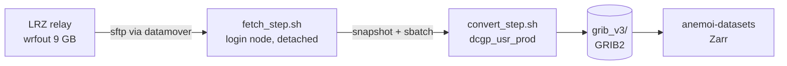

<div align="center">

# CHAPTER

**The 3 km CHAPTER reanalysis of Europe and the Mediterranean, from WRF output to an ECMWF-compatible GRIB2 archive and an Anemoi training dataset.**

[](https://www.python.org/)
[](https://docs.astral.sh/uv/)
[](fortran/)
[-0b6aa2)](https://confluence.ecmwf.int/display/ECC/ecCodes+Home)
[](https://anemoi.readthedocs.io/projects/datasets/)
[-555)](https://leonardo-supercomputer.cineca.eu/)
[](LICENSE)
[](https://doi.org/10.1002/qj.5014)

[Quick start](#quick-start) | [Variables](CHAPTER_VARIABLES.md) | [Known properties](CHAPTER_KNOWN_PROPERTIES.md) | [HPC pipeline](#hpc-pipeline) | [Manual (PDF)](report/en/main.pdf) | [Issues](https://github.com/meteocima/CHAPTER/issues)


</div>

CHAPTER (*Computational Hydrometeorology with Advanced Performance to Enhanced Realism*) is a convection-permitting dynamical downscaling of ERA5 over Europe and the Mediterranean basin, produced with WRF at 3 km ([Bernini et al., 2024](https://doi.org/10.1002/qj.5014)). This repository does not run the model: it converts its hourly `wrfout` files into a GRIB2 archive with ECMWF paramIds, on 13 pressure levels, and from there into an [Anemoi](https://anemoi.readthedocs.io/) Zarr dataset for machine learning.

> [!TIP]
> If you **use** the archive rather than build it, start from **[CHAPTER_VARIABLES.md](CHAPTER_VARIABLES.md)** (what each field is) and **[CHAPTER_KNOWN_PROPERTIES.md](CHAPTER_KNOWN_PROPERTIES.md)** (what is correct but surprising, with the measured numbers). Both are also available as PDF.

## Quick start

```bash
# 1. install (builds the Fortran kernels via CMake + F2PY)
git clone https://github.com/meteocima/CHAPTER.git && cd CHAPTER
uv sync

# 2. load the ecCodes runtime (Leonardo)
source tools/eccodes_env.sh

# 3. convert one timestep and check it
uv run python convert_to_pressure_levels.py \
    --input  wrfout_d02_2024-07-01_14:00:00 \
    --output test.grib --accum-snap-dir accum_snap/
uv run python hpc/check_grib_sanity.py test.grib
```

> [!WARNING]
> A full conversion reads 9 GB and costs ~170 s of CPU: on Leonardo run it **as a SLURM job**, never on a login node (600 s CPU limit per process). See [Testing](#testing) for the `sbatch` line.

## Contents

- [Quick start](#quick-start)
- [At a glance](#at-a-glance)
- [What it does](#what-it-does)
- [Installation](#installation)
- [WRF → GRIB2](#wrf--grib2)
- [GRIB2 → Anemoi Zarr](#grib2--anemoi-zarr)
- [HPC pipeline](#hpc-pipeline)
- [Variables](#variables)
- [Time convention](#time-convention)
- [Testing](#testing)
- [Repository layout](#repository-layout)
- [Documentation](#documentation)
- [References](#references)
- [Contact and license](#contact-and-license)

## At a glance

| | |
|---|---|
| **Domain** | Europe and the Mediterranean basin, WRF domain `d02` |
| **Grid** | 1353 × 1641 points, Mercator (`MAP_PROJ=3`), 3 km; WRF's sphere (R = 6 370 000 m) declared in the GRIB |
| **Vertical** | 50 model levels → 13 pressure levels, 1000–50 hPa |
| **Time step** | hourly; every accumulation is the hour ending at its timestep, as in ERA5 |
| **Schema** | 90 variables, 246 GRIB2 messages per timestep (13 × 13 pressure-level + 77 single-level) |
| **Size** | ~747 MB per timestep, ~17.9 GB per day, ~6.55 TB per year (`grid_ccsds` packing) |
| **Archive** | `grib_v3/` on `/leonardo_work`; 2019, 2024 and 2025 (to 2025-07-02T23) complete, 2020–2023 in progress |

## What it does

| Stage | From → to | Entry point | Runs on | Status |
|---|---|---|---|---|
| **Conversion** | `wrfout_d02_*` (NetCDF) → GRIB2, 246 messages | [`convert_to_pressure_levels.py`](convert_to_pressure_levels.py) | 1 DCGP core, ~6 min, 20 GB RAM |  |
| **Step pipeline** | LRZ (SuperMUC) → Leonardo, fetch + convert per hour | [`hpc/submit_step_pipeline.py`](hpc/submit_step_pipeline.py) | login node + `dcgp_usr_prod` |  |
| **Post-passes** | repairs of the archive without reconversion (#71, #72) | [`hpc/fix_accum_hourly.py`](hpc/fix_accum_hourly.py), [`hpc/fix_00z_run.sh`](hpc/fix_00z_run.sh) | `dcgp_usr_prod` |  |
| **Anemoi dataset** | GRIB2 archive → Zarr, with forcings | [`run_anemoi_pipeline.sh`](run_anemoi_pipeline.sh), [`wrf_anemoi_recipe.yaml`](wrf_anemoi_recipe.yaml) | separate `anemoi/` environment |  |
| **Day pipeline** | SuperMUC rsync, 24 files per day | [`hpc/submit_pipeline.py`](hpc/submit_pipeline.py) | `lrd_all_serial` | -lightgrey) |

The conversion is two steps. A customised **wrf-python 1.4.2** (`src/wrf/` and the Fortran kernels in `fortran/`) computes the derived fields and interpolates model levels to pressure levels; **ecCodes** then encodes GRIB2 (grid template 3.10, `grid_ccsds` packing, ECMWF paramIds). What is produced, and on which level, is defined in one place, the registry `wrf_era5_comparison.WRF_TO_ECMWF_PARAMID`.

## Installation

You need Python 3.10 or later, [uv](https://docs.astral.sh/uv/), gcc/gfortran (OpenMP optional) and the ecCodes C library.

```bash
git clone https://github.com/meteocima/CHAPTER.git
cd CHAPTER
uv sync              # builds the _wrffortran extension through scikit-build-core + CMake
```

The Anemoi step uses its own environment, so the two never pull each other's versions:

```bash
uv sync --project anemoi     # anemoi-datasets 0.5.45
```

> [!NOTE]
> On Leonardo, `source tools/eccodes_env.sh` before any interactive script that imports ecCodes: it loads `eccodes/2.34.0--gcc--12.2.0` and the gcc-12 runtime the Python bindings need. The `grib_*` command-line tools are not installed there.

## WRF → GRIB2

```bash
uv run python convert_to_pressure_levels.py --input <wrfout> --output <grib> --accum-snap-dir <dir>
uv run python convert_to_pressure_levels.py --input <wrfout> --output <grib> --debug-vars T2 tk
```

| Option | Meaning |
|---|---|
| **`--input`, `--output`** | one `wrfout_d02_*` file in, one GRIB2 file out |
| **`--accum-snap-dir`** | accumulator snapshots: the state of the hour before must be here, or its wrfout beside the input |
| **`--debug-vars`** | compute only some fields; plain 2D native fields skip the 3D cache and take ~15 s |

**Input of a 00Z.** The 00Z of day D is the 24 h file of the run for D-1 (`wrfout_d02_<D>_00:00:00` in the `(D-2)18` folder), and the hour before is that run's 23Z. The converter refuses the 00Z of the run for D, which is spin-up (#72).

**Output names** follow `ailam-an-cima-3km-<year>-<year>-1h-v1-<YYYYMMDDHH>.grib`.

**What the converter adds to WRF:**

- specific humidity and specific cloud contents from WRF's mixing ratios, all with the same moist-air denominator;
- `r` and `2r` with ECMWF's mixed-phase saturation ([`ifs_humidity.py`](ifs_humidity.py)), not wrf-python's;
- `skt` inverted from `LWUPB` with the per-category emissivity measured from the run;
- cloud cover by maximum-random overlap, column integrals, soil layers as exact ERA5 layer averages;
- seven static fields from `geo_em.d02` (`cvl`, `cvh`, `tvl`, `tvh`, `slt`, `cl`, `dl`), read once by [`static_ref.py`](static_ref.py) into a 1.8 MB sidecar;
- masks as GRIB bitmaps, where the ERA5 parameter is not defined.

## GRIB2 → Anemoi Zarr

```bash
./run_anemoi_pipeline.sh [recipe.yaml] [output.zarr]   # = uv run --project anemoi anemoi-datasets create ...
```

[`wrf_anemoi_recipe.yaml`](wrf_anemoi_recipe.yaml) reads one GRIB per timestep selected on `valid_datetime`, drops the level from single-level names (`msl`, not `msl_0`), joins the forcings at build time and chunks 64 variables at a time (one whole date is 2.26 GB). The forcings are not in the GRIB:

```yaml
- forcings:
    param: [cos_latitude, sin_latitude, cos_longitude, sin_longitude,
            cos_julian_day, sin_julian_day, cos_local_time, sin_local_time, insolation]
```

> [!IMPORTANT]
> `fal` is missing on every point at night (below 50 W m⁻²), and 16 variables carry a bitmap mask. A training configuration has to impute or drop them.

## HPC pipeline

The wrfout live at LRZ; the archive is built on Leonardo. Files travel through the **CINECA datamover** (`data.leonardo.cineca.it`) and the LRZ data relay, so the bytes never pass through the login node.



```bash
# from a regular login node (the launcher refuses where the datamover is unreachable)
python hpc/submit_step_pipeline.py window.start_date=2025-06-01 window.start_hour=0 \
    window.end_date=2025-06-30 window.end_hour=23

python hpc/submit_step_pipeline.py ... dry_run=true   # preview, no SLURM, no network
python hpc/submit_step_pipeline.py ... report=true    # DONE / MISSING / RECALL table
touch <log_dir>/fetch_step.stop                       # stop the chain (not pkill)
```

| Setting | Value | Why |
|---|---|---|
| **`pipeline.direction`** | `backward` | newest hours first |
| **`batch.fetch_parallel`** | 6 | the measured knee of the relay: ~360 MB/s, no gain beyond (#69) |
| **`batch.max_queued_converts`** | 48 | CINECA cancels and warns on hundreds of queued jobs |
| **`slurm.step_convert_account`** | `aifpt_ailamit_0` | DCGP bills per core, so one core per timestep |

Every outcome is appended to a status ledger (`FETCH_OK`, `CONVERT_SUBMITTED`, `MISSING_ON_LRZ`, `FETCH_TIMEOUT`, `UNREADABLE`…). A missing or on-tape file is logged and skipped, never fatal; the pipeline is re-entrant, so after a recall on LRZ ([`hpc/lrz/`](hpc/lrz/)) the same window is simply run again.

> [!CAUTION]
> Do not edit the repository while a campaign is running: every compute node reads the converter live from `$HOME`, and an edit during a run has already killed 199 convert jobs. Stop the chains, edit, relaunch.

<details>
<summary>Year-scale sequences and download-only mode</summary>

- [`hpc/run_year_rebuild.sh`](hpc/run_year_rebuild.sh) builds whole years month by month (download chain plus background convert chain per phase; `YEARS="2020 2021 2022 2023"`, `PHASES_ONLY` to resume). A year of wrfout is ~80 TB against a 100 TB quota, so it never stages more than a few months.
- [`hpc/run_share_conversion.sh`](hpc/run_share_conversion.sh) converts every wrfout already on local disk.
- `pipeline.download_only=true` fetches and stops: nothing is converted or deleted. Give it its own `paths.wrfout_dir`, `paths.status_log`, `paths.driver_log` and `paths.stop_flag`.
- Configuration lives in [`conf/pipeline.yaml`](conf/pipeline.yaml) (Hydra, every key overridable on the command line); the date → run-folder mapping is in [`hpc/dates.py`](hpc/dates.py).

</details>

## Variables

**90 variables, 246 messages per timestep.** `EXPECTED_MESSAGES` is derived from the registry and [`hpc/check_grib_sanity.py`](hpc/check_grib_sanity.py) enforces it, so a field that fails to compute cannot slip into the archive.

| Group | Variables | Messages |
|---|---|---|
| **Pressure levels** (1000–50 hPa) | `t`, `q`, `r`, `z`, `u`, `v`, `w` (Pa/s), `wz` (m/s), `cc`, `clwc`, `ciwc`, `crwc`, `cswc` | 169 |
| **Single level** | near surface, mean sea level, column integrals, surface, soil `swvl1-4` / `stl1-4`, lake, top of atmosphere and most unstable parcel; 19 of them accumulated | 77 |

Not in the archive: TKE, PBL height, waves and ocean fields, `TSK`, `HFX`, `LH`. Why, and by which other route some could be obtained, is in [MISSING_VARIABLES.md](MISSING_VARIABLES.md).

## Time convention

| Field type | Encoding | Reference time |
|---|---|---|
| Instantaneous | product definition template 0 | the valid time |
| Accumulated, `10fg` | product definition template 8, step `0-1` | H-1 (at 00Z, 23Z of the day before) |

Every file is one state of one run. The 00Z of day D is the last hour of the run for D-1 (lead 30), so the six spin-up hours of each run are never published (#72).

> [!IMPORTANT]
> Index the archive on **validity time**, never on `dataTime`, and do not use `generatingProcessIdentifier`: it is 128 on every message.

## Testing

```bash
uv run pytest                    # unit tests, a few seconds, no environment needed
tools/run_anemoi_test.sh         # GRIB -> Zarr end to end on three timesteps, as a SLURM job
```

The tests cover the ledger tokens, the convert queue gate, the hourly accumulations, the archive post-pass and the two 00Z paths of the converter. The conversion itself is checked by hand: a full run as a SLURM job, then `check_grib_sanity.py`, then the values read back against the wrfout, on a 00Z and on a March file.

<details>
<summary>Full conversion as a SLURM job</summary>

```bash
W=/leonardo_work/AIFPT_AILAMIT/CHAPTER
sbatch --partition dcgp_usr_prod --account aifpt_ailamit_0 --nodes 1 --ntasks 1 \
  --cpus-per-task 1 --mem 32G --time 01:00:00 --wrap "cd $PWD
source tools/eccodes_env.sh
/usr/bin/time -v \$HOME/.local/bin/uv run python convert_to_pressure_levels.py \
  --input \$W/wrfout_share/2024-07-01/wrfout_d02_2024-07-01_14:00:00 \
  --output \$W/grib_test/test.grib --accum-snap-dir \$W/accum_snap_test"
```

</details>

## Repository layout

<details>
<summary>Show the repository files</summary>

```
convert_to_pressure_levels.py   converter: one wrfout -> one GRIB2 file
wrf_era5_comparison.py          variable registry and EXPECTED_MESSAGES
accum_hourly.py                 hourly accumulations and accumulator snapshots
accum_ref.py                    accumulated variable list, legacy 00Z sidecars
static_ref.py                   geo_em.d02 -> static sidecar (cvl, cvh, tvl, tvh, slt, cl, dl)
ifs_humidity.py                 ECMWF relative humidity (IFS Cy41r2)
src/wrf/                        customised wrf-python 1.4.2
fortran/                        Fortran kernels, built with F2PY
wrf_anemoi_recipe.yaml          Anemoi recipe over grib_v3
run_anemoi_pipeline.sh          GRIB -> Zarr
anemoi/                         separate uv environment for anemoi-datasets
conf/pipeline.yaml              Hydra configuration of the HPC pipeline
hpc/                            Leonardo pipeline, post-passes, sanity checks
  submit_step_pipeline.py       launcher of the step pipeline
  fetch_step.sh                 login-node fetch driver
  convert_step.sh               single-timestep convert job
  check_grib_sanity.py          full message inventory check
  fix_accum_hourly.py           post-pass #71
  fix_00z_run.sh                post-pass #72
  lrz/                          scan and tape recall, to run on LRZ
tools/                          ecCodes env, md2pdf, test launchers
tests/                          pytest
docs/audit/                     how every number of the variable audit was measured
report/                         LaTeX manual, Italian (report/) and English (report/en/)
```

</details>

## Documentation

| Document | Content |
|---|---|
| **[CHAPTER_VARIABLES.md](CHAPTER_VARIABLES.md)** ([PDF](CHAPTER_VARIABLES.pdf)) | every variable: paramId, units, derivation, masks, time convention |
| **[CHAPTER_KNOWN_PROPERTIES.md](CHAPTER_KNOWN_PROPERTIES.md)** ([PDF](CHAPTER_KNOWN_PROPERTIES.pdf)) | what is correct and surprising, each property with its measured number |
| [MISSING_VARIABLES.md](MISSING_VARIABLES.md) ([PDF](MISSING_VARIABLES.pdf)) | what these wrfout cannot give, and the possible workarounds |
| [Manual, English](report/en/main.pdf) · [Manuale, italiano](report/main.pdf) | the GRIB2 archive of the CHAPTER reanalysis, as a technical report |
| [docs/audit/](docs/audit/) | the September 2026 variable audit: harness, measurements, exclusions |
| [CONTEXT.md](CONTEXT.md) | glossary: run, lead, state, snapshot, ledger… |
| [CLAUDE.md](CLAUDE.md) | developer notes: architecture, HPC gotchas, the reasoning behind each choice |
| [meteoswiss_variable_comparison.md](meteoswiss_variable_comparison.md) | the original comparison with the MeteoSwiss / COSMO training lists |
| [Issues](https://github.com/meteocima/CHAPTER/issues) | work in progress and diagnoses |

## References

- Bernini, L., Lagasio, M., Milelli, M., Oberto, E., Parodi, A., Hachinger, S., Kranzlmüller, D., & Tartaglione, N. (2024). **Convection-permitting dynamical downscaling of ERA5 for Europe and the Mediterranean basin**. *Quarterly Journal of the Royal Meteorological Society*. https://doi.org/10.1002/qj.5014
- [ECMWF Parameter Database](https://codes.ecmwf.int/grib/param-db/) · [ecCodes](https://confluence.ecmwf.int/display/ECC/ecCodes+Home)
- [anemoi-datasets](https://anemoi.readthedocs.io/projects/datasets/) · [recipes](https://anemoi.readthedocs.io/projects/datasets/en/latest/howtos/create/)
- [wrf-python](https://wrf-python.readthedocs.io/)

## Contact and license

**Contact:** Luca Monaco, Fondazione CIMA (CIMA Research Foundation). Report errors and requests in the [issues](https://github.com/meteocima/CHAPTER/issues).

**License:** the code is distributed under the [Apache License 2.0](LICENSE); `src/wrf/` and `fortran/` derive from [wrf-python](https://github.com/NCAR/wrf-python), also Apache 2.0, as recorded in [NOTICE](NOTICE). The CHAPTER data remain under the terms of their producers.
