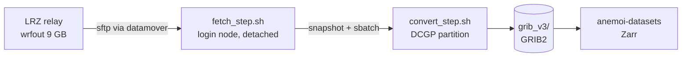

<div align="center">

# CHAPTER_LAM_AI

**CHAPTER for the LAM AI project: the 3 km WRF output fetched from LRZ to Leonardo and turned into an ECMWF-compatible GRIB2 archive and Anemoi training datasets.**

[](#chapter_lam_ai)
[](https://www.python.org/)
[](https://docs.astral.sh/uv/)
[](fortran/)
[-0b6aa2)](https://confluence.ecmwf.int/display/ECC/ecCodes+Home)
[](https://anemoi.readthedocs.io/projects/datasets/)
[-555)](https://leonardo-supercomputer.cineca.eu/)
[](LICENSE)
[](#data-access-and-citation)
[](https://doi.org/10.1002/qj.5014)

[Quick start](#quick-start) | [Variables](CHAPTER_VARIABLES.md) | [Known properties](CHAPTER_KNOWN_PROPERTIES.md) | [HPC pipeline](#hpc-pipeline) | [Manual (PDF)](report/en/main.pdf) | [Issues](https://github.com/meteocima/CHAPTER_LAM_AI/issues)


</div>

CHAPTER (*Computational Hydrometeorology with Advanced Performance to Enhanced Realism*) is a convection-permitting dynamical downscaling of ERA5 over Europe and the Mediterranean basin, produced with WRF at 3 km ([Bernini et al., 2025](https://doi.org/10.1002/qj.5014)). Its hourly `wrfout` files are archived at LRZ (Leibniz Supercomputing Centre).

This repository is specific to the **LAM AI** project. It does not run the model: it fetches the CHAPTER `wrfout` from LRZ to Leonardo, the CINECA supercomputer, converts them into a GRIB2 archive with ECMWF paramIds on 13 pressure levels, and builds from it the [Anemoi](https://anemoi.readthedocs.io/) Zarr datasets LAM AI trains on. The variable set, the ERA5 conventions and the Leonardo pipeline are all chosen for that use.

> [!TIP]
> If you use the archive rather than build it, start from [CHAPTER_VARIABLES.md](CHAPTER_VARIABLES.md), which says what each field is, and [CHAPTER_KNOWN_PROPERTIES.md](CHAPTER_KNOWN_PROPERTIES.md), which lists what is correct but surprising, with the measured numbers. Both are also available as PDF.

## Quick start

```bash
# 1. install: see "Installation" below
uv sync

# 2. load the ecCodes runtime (Leonardo)
source tools/eccodes_env.sh

# 3. convert one timestep and check it; the 13:00 wrfout must sit beside the 14:00 one
uv run python convert_to_pressure_levels.py \
    --input  wrfout_d02_2024-07-01_14:00:00 \
    --output test.grib --accum-snap-dir accum_snap/
uv run python hpc/check_grib_sanity.py test.grib
```

The converter needs the hour before the input as well, because every accumulation is the difference between two consecutive states: either that hour's wrfout in the same directory, or its snapshot in `--accum-snap-dir`. The `wrfout` files are the CHAPTER model output and are not distributed with this repository.

> [!WARNING]
> On Leonardo, run a full conversion as a SLURM job, not on a login node. The login nodes stop any process after 600 s of CPU, and the full-domain CAPE computation alone is killed there. The `sbatch` line is in [Testing](#testing).

## Contents

- [Quick start](#quick-start)
- [At a glance](#at-a-glance)
- [What it does](#what-it-does)
- [Installation](#installation)
- [WRF to GRIB2](#wrf-to-grib2)
- [GRIB2 to Anemoi Zarr](#grib2-to-anemoi-zarr)
- [HPC pipeline](#hpc-pipeline)
- [Variables](#variables)
- [Time convention](#time-convention)
- [Testing](#testing)
- [Repository layout](#repository-layout)
- [Documentation](#documentation)
- [Data access and citation](#data-access-and-citation)
- [Contact and licence](#contact-and-licence)

## At a glance

| | |
|---|---|
| Domain | Europe and the Mediterranean basin, WRF domain `d02` |
| Grid | 1353 × 1641 points, Mercator projection, 3 km; WRF's spherical Earth (radius 6370 km) declared in the GRIB |
| Vertical | from 50 model levels to 13 pressure levels, 1000 to 50 hPa |
| Time step | hourly; every accumulation covers the hour ending at its timestep, as in ERA5 |
| Schema | 90 variables, 246 GRIB2 messages per timestep (13 × 13 on pressure levels, 77 single-level) |
| Size | about 747 MB per timestep, 17.9 GB per day, 6.55 TB per year (`grid_ccsds` packing) |
| Archive (as of 2026-10-16) | 2019, 2024 and 2025 up to 2025-07-02T23 complete; 2020 to 2023 in production |

## What it does

| Stage | From / To | Entry point | Runs on |
|---|---|---|---|
| Conversion | `wrfout_d02_*` (NetCDF) to GRIB2, 246 messages | [`convert_to_pressure_levels.py`](convert_to_pressure_levels.py) | 1 core, about 6 min wall time, 20 GB RAM |
| Step pipeline | fetch from LRZ and convert, one job per hour | [`hpc/submit_step_pipeline.py`](hpc/submit_step_pipeline.py) | Leonardo login node and DCGP partition |
| Anemoi dataset | GRIB2 archive to Zarr, with forcings | [`run_anemoi_pipeline.sh`](run_anemoi_pipeline.sh), [`wrf_anemoi_recipe.yaml`](wrf_anemoi_recipe.yaml) | separate `anemoi/` environment |

The conversion has two steps. A customised wrf-python 1.4.2 (`src/wrf/` and the Fortran kernels in `fortran/`) computes the derived fields and interpolates model levels to pressure levels; ecCodes then encodes GRIB2 (grid template 3.10, `grid_ccsds` packing, ECMWF paramIds). What is produced, and on which level, is defined in one place: the registry `wrf_era5_comparison.WRF_TO_ECMWF_PARAMID`.

## Installation

You need Python 3.10 or later, [uv](https://docs.astral.sh/uv/), gcc and gfortran (OpenMP optional) and the ecCodes C library.

```bash
git clone https://github.com/meteocima/CHAPTER_LAM_AI.git
cd CHAPTER_LAM_AI
uv sync                      # builds the _wrffortran extension through scikit-build-core and CMake
uv sync --project anemoi     # the Anemoi step, in its own environment (anemoi-datasets 0.5.45)
```

The two environments are separate so that neither pulls the other's package versions.

> [!NOTE]
> On Leonardo, `source tools/eccodes_env.sh` before any interactive script that imports ecCodes: it loads `eccodes/2.34.0--gcc--12.2.0` and the gcc-12 runtime the Python bindings need. Elsewhere, install the ecCodes library with your package manager. The code is developed and tested on Leonardo only.

## WRF to GRIB2

```bash
uv run python convert_to_pressure_levels.py --input <wrfout> --output <grib> --accum-snap-dir <dir>
uv run python convert_to_pressure_levels.py --input <wrfout> --output <grib> --debug-vars T2 tk
```

| Option | Meaning |
|---|---|
| `--input`, `--output` | one `wrfout_d02_*` file in, one GRIB2 file out |
| `--accum-snap-dir` | accumulator snapshots: the state of the hour before must be here, or its wrfout beside the input |
| `--debug-vars` | compute only some fields; plain 2D native fields skip the 3D cache and take about 15 s |

**Input of a 00Z.** The 00Z of day D is the 24 h file of the run for D-1 (`wrfout_d02_<D>_00:00:00` in the `(D-2)18` folder), and the hour before is that run's 23Z. The converter refuses the 00Z of the run for D, which is still in spin-up ([#72](https://github.com/meteocima/CHAPTER_LAM_AI/issues/72)).

Output files are named `ailam-an-cima-3km-<year>-<year>-1h-v1-<YYYYMMDDHH>.grib`.

What the converter adds to WRF:

- specific humidity and specific cloud contents from WRF's mixing ratios, all with the same moist-air denominator;
- `r` and `2r` with ECMWF's mixed-phase saturation ([`ifs_humidity.py`](ifs_humidity.py)), not wrf-python's;
- `skt` inverted from the outgoing longwave flux, with the per-category emissivity measured from the run;
- cloud cover by maximum-random overlap, column integrals, soil layers as exact ERA5 layer averages;
- seven static fields from `geo_em.d02` (`cvl`, `cvh`, `tvl`, `tvh`, `slt`, `cl`, `dl`), read once by [`static_ref.py`](static_ref.py) into a 1.8 MB sidecar;
- masks as GRIB bitmaps, where the ERA5 parameter is not defined.

## GRIB2 to Anemoi Zarr

```bash
./run_anemoi_pipeline.sh [recipe.yaml] [output.zarr]   # = uv run --project anemoi anemoi-datasets create ...
```

[`wrf_anemoi_recipe.yaml`](wrf_anemoi_recipe.yaml) reads one GRIB per timestep selected on `valid_datetime`, drops the level from single-level names (`msl`, not `msl_0`), joins the forcings at build time and chunks 64 variables at a time, since one whole date is 2.26 GB. The forcings are not in the GRIB:

```yaml
- forcings:
    param: [cos_latitude, sin_latitude, cos_longitude, sin_longitude,
            cos_julian_day, sin_julian_day, cos_local_time, sin_local_time, insolation]
```

> [!IMPORTANT]
> Sixteen variables are missing on part of the grid: `sst`, `ci`, `tsn`, `fal`, `tvl`, `slt`, `dl`, `swvl1-4`, `stl1-4` and `mucin`. Most are masked where the ERA5 parameter is not defined (`sst` over land, the soil columns over water). `fal`, the forecast albedo, exists only in daytime: it is missing everywhere when the incoming shortwave radiation is below 50 W m⁻². A training configuration has to impute the missing points or leave the variable out.

## HPC pipeline

The `wrfout` files are stored at LRZ; the archive is built on Leonardo. Files travel through the CINECA datamover (`data.leonardo.cineca.it`) and the LRZ data relay, so the data do not pass through the login node.



```bash
# from a regular login node (the launcher refuses where the datamover is unreachable)
python hpc/submit_step_pipeline.py window.start_date=2025-06-01 window.start_hour=0 \
    window.end_date=2025-06-30 window.end_hour=23

python hpc/submit_step_pipeline.py ... dry_run=true   # preview, no SLURM, no network
python hpc/submit_step_pipeline.py ... report=true    # DONE / MISSING / RECALL table
touch <log_dir>/fetch_step.stop                       # stop the chain (not pkill)
```

Convert jobs are submitted with SLURM to `dcgp_usr_prod`, Leonardo's Data Centric General Purpose partition.

| Setting | Value | Why |
|---|---|---|
| `pipeline.direction` | `backward` | newest hours first |
| `batch.fetch_parallel` | 6 | the measured knee of the relay, about 360 MB/s; more streams add no bandwidth ([#69](https://github.com/meteocima/CHAPTER_LAM_AI/issues/69)) |
| `batch.max_queued_converts` | 48 | CINECA cancels and warns on hundreds of queued jobs |
| `slurm.step_convert_account` | `<account>` | the partition bills per core, so one core per timestep |

Every outcome is appended to a status ledger (`FETCH_OK`, `CONVERT_SUBMITTED`, `MISSING_ON_LRZ`, `FETCH_TIMEOUT`, `UNREADABLE` and the other tokens listed in `hpc/ledger.TOKEN_KINDS`). A missing or on-tape file is logged and skipped, and the chain goes on. The pipeline is re-entrant: after a tape recall on LRZ ([`hpc/lrz/`](hpc/lrz/)) the same window is run again.

> [!CAUTION]
> Do not edit the repository while a campaign is running. Every compute node reads the converter from `$HOME` at run time, and an edit during a run makes convert jobs fail. Stop the chains, edit, relaunch.

<details>
<summary>Year-scale sequences and download-only mode</summary>

- [`hpc/run_year_rebuild.sh`](hpc/run_year_rebuild.sh) builds whole years month by month, with a download chain and a background convert chain per phase (`YEARS="2020 2021 2022 2023"`, `PHASES_ONLY` to resume). A year of `wrfout` is about 80 TB, so it stages a few months at a time.
- [`hpc/run_share_conversion.sh`](hpc/run_share_conversion.sh) converts every `wrfout` already on local disk.
- `pipeline.download_only=true` fetches and stops: nothing is converted or deleted. Give it its own `paths.wrfout_dir`, `paths.status_log`, `paths.driver_log` and `paths.stop_flag`.
- Configuration lives in [`conf/pipeline.yaml`](conf/pipeline.yaml) (Hydra, every key can be overridden on the command line); the mapping from date to run folder is in [`hpc/dates.py`](hpc/dates.py).
- The day pipeline ([`hpc/submit_pipeline.py`](hpc/submit_pipeline.py), `fetch_day.sh`, `convert_day.sh`) is retired: it does not fetch the 24 h file a 00Z needs ([#71](https://github.com/meteocima/CHAPTER_LAM_AI/issues/71)).

</details>

## Variables

90 variables, 246 messages per timestep. `EXPECTED_MESSAGES` is derived from the registry and [`hpc/check_grib_sanity.py`](hpc/check_grib_sanity.py) enforces it, so a field that fails to compute shows up as a missing message.

| Group | Variables | Messages |
|---|---|---|
| Pressure levels (1000 to 50 hPa) | `t`, `q`, `r`, `z`, `u`, `v`, `w` (Pa/s), `wz` (m/s), `cc`, `clwc`, `ciwc`, `crwc`, `cswc` | 169 |
| Single level | near surface, mean sea level, column integrals, surface, soil `swvl1-4` and `stl1-4`, lake, top of atmosphere and most unstable parcel; 19 of them accumulated | 77 |

Not in the archive: turbulent kinetic energy (TKE), planetary boundary layer (PBL) height, waves and ocean fields, and the surface sensible and latent heat fluxes. The skin temperature is published as `skt`, reconstructed from the outgoing longwave flux, because WRF's own skin temperature was not written to the output. Why each field is missing, and by which other route some could be obtained, is in [MISSING_VARIABLES.md](MISSING_VARIABLES.md).

## Time convention

| Field type | Encoding | Reference time |
|---|---|---|
| Instantaneous | product definition template 0 | the valid time |
| Accumulated, and `10fg` | product definition template 8, step `0-1` | H-1 (at 00Z, 23Z of the day before) |

Each WRF run starts at 18Z of the day before and lasts 30 hours; its first six hours are spin-up and are not published. Every file is one state of one run: the 00Z of day D is the last hour of the run for D-1 (lead 30), and 01Z comes from the run for D (lead 7). The archive therefore switches run once a day, between 00Z and 01Z ([#72](https://github.com/meteocima/CHAPTER_LAM_AI/issues/72)).

> [!IMPORTANT]
> Index the archive on validity time, not on `dataTime`, and do not use `generatingProcessIdentifier`: it is 128 on every message.

## Testing

```bash
uv run pytest                    # unit tests, a few seconds, no environment needed
tools/run_anemoi_test.sh         # GRIB to Zarr end to end on three timesteps, as a SLURM job
```

The tests cover the ledger tokens, the convert queue gate, the hourly accumulations, the archive post-pass and the two 00Z paths of the converter. The conversion itself is checked by hand: a full run as a SLURM job, then `check_grib_sanity.py`, then the values read back against the `wrfout`, on a 00Z file and on a March file.

<details>
<summary>Full conversion as a SLURM job</summary>

```bash
W=<work_dir>
sbatch --partition dcgp_usr_prod --account <account> --nodes 1 --ntasks 1 \
  --cpus-per-task 1 --mem 32G --time 01:00:00 --wrap "cd $PWD
source tools/eccodes_env.sh
/usr/bin/time -v \$HOME/.local/bin/uv run python convert_to_pressure_levels.py \
  --input \$W/wrfout_share/2024-07-01/wrfout_d02_2024-07-01_14:00:00 \
  --output \$W/grib_test/test.grib --accum-snap-dir \$W/accum_snap_test"
```

</details>

## Repository layout

<details>
<summary>Show the repository files</summary>

```
convert_to_pressure_levels.py   converter: one wrfout -> one GRIB2 file
wrf_era5_comparison.py          variable registry and EXPECTED_MESSAGES
accum_hourly.py                 hourly accumulations and accumulator snapshots
accum_ref.py                    accumulated variable list, legacy 00Z sidecars
static_ref.py                   geo_em.d02 -> static sidecar (cvl, cvh, tvl, tvh, slt, cl, dl)
ifs_humidity.py                 ECMWF relative humidity (IFS Cy41r2)
src/wrf/                        customised wrf-python 1.4.2
fortran/                        Fortran kernels, built with F2PY
wrf_anemoi_recipe.yaml          Anemoi recipe over grib_v3
run_anemoi_pipeline.sh          GRIB -> Zarr
anemoi/                         separate uv environment for anemoi-datasets
conf/pipeline.yaml              Hydra configuration of the HPC pipeline
hpc/                            Leonardo pipeline, post-passes, sanity checks
  submit_step_pipeline.py       launcher of the step pipeline
  fetch_step.sh                 login-node fetch driver
  convert_step.sh               single-timestep convert job
  check_grib_sanity.py          full message inventory check
  fix_accum_hourly.py           post-pass: hourly accumulations (#71)
  fix_00z_run.sh                post-pass: 00Z from the previous run (#72)
  lrz/                          scan and tape recall, to run on LRZ
tools/                          ecCodes environment, md2pdf, test launchers
tests/                          pytest
docs/audit/                     how every number of the variable audit was measured
report/                         LaTeX manual, Italian (report/) and English (report/en/)
```

</details>

## Documentation

| Document | Content |
|---|---|
| [CHAPTER_VARIABLES.md](CHAPTER_VARIABLES.md) ([PDF](CHAPTER_VARIABLES.pdf)) | every variable: paramId, units, derivation, masks, time convention |
| [CHAPTER_KNOWN_PROPERTIES.md](CHAPTER_KNOWN_PROPERTIES.md) ([PDF](CHAPTER_KNOWN_PROPERTIES.pdf)) | what is correct and surprising, each property with its measured number |
| [MISSING_VARIABLES.md](MISSING_VARIABLES.md) ([PDF](MISSING_VARIABLES.pdf)) | what these `wrfout` cannot give, and the possible workarounds |
| [Manual, English](report/en/main.pdf), [Manuale, italiano](report/main.pdf) | the CHAPTER GRIB2 archive, as a technical report |
| [docs/audit/](docs/audit/) | the September 2026 variable audit: harness, measurements, exclusions |
| [CONTEXT.md](CONTEXT.md) | glossary of the terms used across the repository |
| [CLAUDE.md](CLAUDE.md) | developer notes: architecture, HPC pitfalls, the reasoning behind each choice |
| [meteoswiss_variable_comparison.md](meteoswiss_variable_comparison.md) | the original comparison with the MeteoSwiss and COSMO training lists |
| [Issues](https://github.com/meteocima/CHAPTER_LAM_AI/issues) | work in progress and diagnoses |

References: [ECMWF Parameter Database](https://codes.ecmwf.int/grib/param-db/), [ecCodes](https://confluence.ecmwf.int/display/ECC/ecCodes+Home), [anemoi-datasets](https://anemoi.readthedocs.io/projects/datasets/) and its [recipes](https://anemoi.readthedocs.io/projects/datasets/en/latest/howtos/create/), [wrf-python](https://wrf-python.readthedocs.io/).

## Data access and citation

The GRIB2 archive and the Anemoi datasets built from it are for the internal use of the LAM AI project and are not distributed. This repository holds the conversion code only.

To cite CHAPTER:

> Bernini, L., Lagasio, M., Milelli, M., Oberto, E., Parodi, A., Hachinger, S., Kranzlmüller, D., & Tartaglione, N. (2025). Convection-permitting dynamical downscaling of ERA5 for Europe and the Mediterranean basin. *Quarterly Journal of the Royal Meteorological Society*, 151(772). https://doi.org/10.1002/qj.5014

## Contact and licence

**Contact:** Luca Monaco, Fondazione CIMA (CIMA Research Foundation). Report errors and requests in the [issues](https://github.com/meteocima/CHAPTER_LAM_AI/issues).

**Licence:** the code is distributed under the [Apache License 2.0](LICENSE). `src/wrf/` and `fortran/` derive from [wrf-python](https://github.com/NCAR/wrf-python), also under the Apache License 2.0, as recorded in [NOTICE](NOTICE). The CHAPTER data are for internal use and are not covered by this licence.
